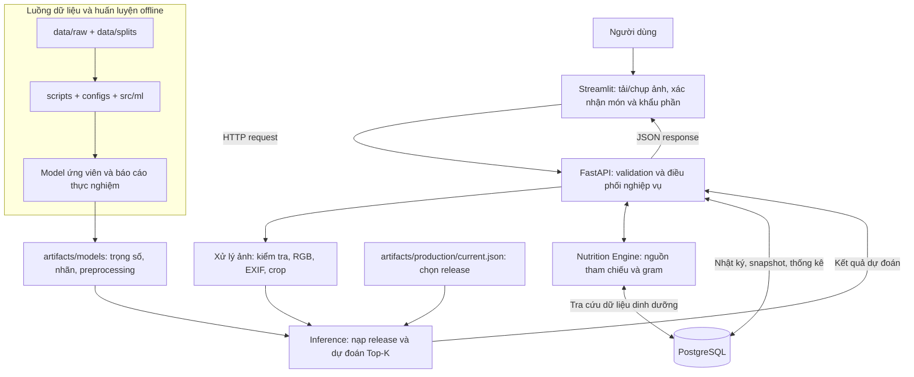

# Food Recognition & Dietary Assistant

**Tiếp tục từ trạng thái hiện tại:** đọc [RUN_COMMANDS.md](RUN_COMMANDS.md).
Tác vụ dài được bạn chủ động chạy từng bước trong Terminal; script tổng hợp mặc định chỉ in lệnh.

**POC AI thật hiện tại:** production `efficientnet_b0/poc10-rtx3050-v1` đã có checkpoint
và kết quả test được lưu (Accuracy 89.80%). Phiên bổ sung Nutrition không huấn luyện
hoặc đánh giá lại model. Hướng dẫn training độc lập giữ tại [POC_REAL_AI.md](POC_REAL_AI.md).

**Dinh dưỡng tự động cho 10 lớp:** xem [NUTRITION_GUIDE.md](NUTRITION_GUIDE.md) để
nạp catalog USDA, khởi động lại ứng dụng và kiểm tra Hamburger/Kem/Pizza. Gram S/M/L
là quy ước thiết kế có ghi chú; không đo khối lượng bằng ảnh. Không cần migration mới.

Ứng dụng local một người dùng: **Streamlit → FastAPI → PostgreSQL**, nhận ảnh/crop,
xác nhận món và khẩu phần, ước tính dinh dưỡng có nguồn, lưu nhật ký và xem dashboard.
Pipeline HOG + SVM, ResNet18 và EfficientNet-B0 chạy offline, tách khỏi ứng dụng.

**Trạng thái thực tế:** đã chạy end-to-end với Mock AI trên Windows và Docker Compose;
cả ba container healthy, HTTP smoke đã đạt. Food-101 đã tải đủ 101.000 ảnh, POC 10 lớp
đã tạo manifest 6.000 train / 1.500 val / 2.500 test. Trạng thái huấn luyện và kết quả
thật được cập nhật tại [IMPLEMENTATION_STATUS.md](IMPLEMENTATION_STATUS.md) và
[MODEL_EVALUATION_REPORT.md](MODEL_EVALUATION_REPORT.md). Mock và smoke training
không được dùng làm kết quả thực nghiệm.

## Sơ đồ cấu trúc hệ thống

Ứng dụng đang chạy và quy trình huấn luyện là hai luồng riêng. Website đọc model đã
được chọn để nhận diện; mở website không tự huấn luyện lại model.



Người dùng xác nhận món/khẩu phần trước khi API lưu bữa ăn. Kcal và macro được tính
từ nguồn tham chiếu theo gram, không đo trực tiếp từ ảnh. Model mới trong thư mục
101 lớp **không tự thay thế** model website; việc triển khai phải được chọn riêng qua
production pointer. Sơ đồ chi tiết hơn: [diagrams/README.md](diagrams/README.md).

## Cây thư mục và vai trò từng phần

Thư mục gốc để chạy lệnh là thư mục chứa `pyproject.toml`, `README.md` và `src/`.
Trên máy hiện tại: `D:\food-recognition-dietary-assistant\food-recognition-dietary-assistant`.
Cây dưới đây lược bỏ cache và liệt kê các thành phần chính đang có trong repository.

```text
food-recognition-dietary-assistant/
├── src/food_assistant/          # Toàn bộ mã nguồn chính: backend, frontend và AI
│   ├── api/                    # FastAPI: endpoint, request/response và lỗi HTTP
│   ├── services/               # Nghiệp vụ: nhận diện, khẩu phần, dinh dưỡng, nhật ký
│   ├── persistence/            # SQLAlchemy: ORM, session, repository và seed
│   ├── domain/                 # Pydantic schemas, enum và lỗi nghiệp vụ dùng chung
│   ├── ml/                     # Dataset, transform, HOG, kiến trúc và vòng lặp training
│   ├── nutrition/              # Chuẩn bị/kiểm tra catalog USDA và dữ liệu tham chiếu
│   ├── ui/                     # Giao diện Streamlit gọi backend qua HTTP
│   │   ├── pages/              # Home, nhận diện, nhật ký, thống kê, thông tin model
│   │   ├── components/         # Crop ảnh, bảng dự đoán và card dinh dưỡng
│   │   └── assets/             # Ảnh banner và minh họa giao diện
│   ├── utils/                  # Tiện ích: đường dẫn, logging, khóa tiến trình...
│   ├── config.py               # Đọc biến môi trường và cấu hình runtime
│   └── app.py                  # Điểm khởi chạy và điều hướng frontend Streamlit
├── scripts/                    # Các file thực thi từ Terminal
│   ├── train_resnet18.py        # Gọi pipeline training ResNet18
│   ├── train_efficientnet_b0.py # Gọi pipeline training EfficientNet-B0
│   ├── train_hog_svm.py         # Gọi pipeline HOG + SVM
│   ├── train_food101_101.ps1    # Launcher 101 lớp, chọn model, log và resume CNN
│   ├── verify_dataset.py       # Kiểm tra dữ liệu/manifest; hỗ trợ full audit
│   ├── prepare_food101_from_audit.py # Tạo split chống leakage từ audit đã có
│   └── ...                     # Downloader, seed, notebook, đánh giá, smoke test...
├── configs/                    # File tham số YAML/JSON, không phải checkpoint
│   ├── poc/                    # Profile POC 10 lớp
│   └── food101_101/             # Profile 101 lớp cho ba mô hình
├── data/
│   ├── raw/                    # Dataset gốc và archive nguồn; không sửa khi training
│   ├── splits/                 # CSV manifest, labels.json, metadata, train/val/test
│   │   ├── v1/                 # POC 10 lớp: 6.000 / 1.500 / 2.500 ảnh
│   │   └── food101-101-v2/      # 101 lớp: 60.598 / 15.150 / 25.250 ảnh
│   ├── nutrition/              # Catalog, mapping món–USDA, nguồn và coverage
│   ├── processed/              # Vùng dành cho dữ liệu tiền xử lý xuất offline
│   └── local_eval/             # Vùng dành cho dữ liệu đánh giá cục bộ riêng
├── artifacts/                  # Sản phẩm của thí nghiệm, không phải mã nguồn
│   ├── models/
│   │   ├── efficientnet_b0/    # Các run POC 10 lớp
│   │   ├── resnet18/           # Các run POC 10 lớp
│   │   ├── hog_svm/            # Các run POC 10 lớp
│   │   ├── food101_101/        # Các run 101 lớp, tách riêng theo model/run_id
│   │   └── .locks/            # Khóa chống chạy trùng, không phải model
│   ├── pretrained/            # Cache trọng số ImageNet ban đầu
│   ├── production/            # Pointer chọn release phục vụ website
│   └── reports/               # Metrics, confusion matrix, audit, log, hình báo cáo
├── notebooks/                 # Thực nghiệm và giải thích phục vụ báo cáo giữa kỳ
│   ├── midterm_image_processing_demo.ipynb # Bản chính, đã có output
│   └── notebooks/             # Bản tương thích đường dẫn ban đầu, không phải phần khác
├── contracts/                 # JSON Schema và response mẫu của hệ thống
├── migrations/                # Alembic: các phiên bản thay đổi cấu trúc PostgreSQL
├── tests/                     # Kiểm thử: unit, integration và smoke
├── docs/                      # Giải thích kiến trúc, dữ liệu, giới hạn và thí nghiệm
├── diagrams/                  # Sơ đồ Mermaid hệ thống, database và các luồng xử lý
├── storage/                   # File runtime: uploads và dữ liệu tạm
├── .streamlit/                # Theme/cấu hình Streamlit và ảnh tham khảo giao diện
├── .venv/                     # Môi trường Python local cho CPU/phát triển/notebook
├── .venv-cuda/                # Môi trường Python local có PyTorch CUDA
├── .env.example               # Mẫu biến môi trường; .env thật chỉ dùng ở máy local
├── pyproject.toml             # Khai báo package, dependencies và cấu hình công cụ
├── requirements-lock.txt      # Phiên bản dependencies cho môi trường ML/phát triển
├── requirements-runtime-lock.txt # Phiên bản dependencies cho runtime nhẹ
├── Dockerfile                 # Đóng gói ứng dụng; tùy chọn cài thêm ML
├── docker-compose.yml         # PostgreSQL + backend + frontend, volume/network
└── alembic.ini                # Cấu hình chạy migration database
```

### Phân biệt các thư mục dễ nhầm

| Phần | Chứa gì? | Ví dụ |
|---|---|---|
| `configs/` | Tham số để chạy, có thể chỉnh cho thí nghiệm mới | Số lớp kỳ vọng, batch size, learning rate, epoch |
| `scripts/` | Điểm gọi thực thi từ Terminal | `train_resnet18.py` đọc file config và gọi training |
| `src/` | Các hàm/lớp thực sự thực hiện công việc | `ml/train_utils.py` chạy loop; `api/` là backend; `ui/` là frontend |
| `artifacts/models/` | Model và hợp đồng dữ liệu của từng lần chạy | `model.pth`, `model.joblib`, `labels.json`, `preprocessing.json` |
| `artifacts/pretrained/` | Trọng số khởi tạo từ ImageNet | Chưa phải model phân loại món ăn đã fine-tune |
| `artifacts/production/` | Tham chiếu release đã chọn | `current.json` trỏ tới model, không chứa toàn bộ trọng số |
| `data/splits/` | Danh sách ảnh/nhãn/split/checksum | Không chứa các file ảnh; đường dẫn trỏ về `data/raw/` |

Trong mỗi thư mục model có nhiều `run_id`; **có thư mục không đồng nghĩa đã train xong**.
Kiểm tra `model_config.json` (`trained`, `num_classes`, `dataset_version`) và checksum.
Không dùng số liệu 10 lớp như kết quả của 101 lớp.

Ảnh không bắt buộc được xuất lại vào `data/processed/`: pipeline hiện resize/crop/
normalize ngay khi DataLoader hoặc inference đọc ảnh. Thư mục đó trống không có nghĩa
là thiếu tiền xử lý. Website cũng không đọc notebook để nhận diện; notebook chỉ tái
sử dụng một số hàm trong `src/` để minh họa và kiểm chứng.

### Clone repository và dữ liệu đi kèm

Đưa lên Git mã nguồn, cấu hình, notebook, manifest/nhãn, tài liệu và báo cáo nhỏ cần
tái lập. `.gitignore` loại `.env`, môi trường Python, raw dataset, pretrained weights,
checkpoints và file runtime; vì vậy **clone code chưa đủ để chạy mọi chức năng**.

- Chỉ xem notebook: có thể đọc các output đã lưu mà chưa cần chạy kernel.
- Chạy lại notebook: cần Python 3.11, thư viện, ảnh mẫu và artifact POC mà notebook
  đọc. Không cần GPU/database hoặc checkpoint CNN để chỉ đọc metric CNN đã lưu.
  Xem [notebooks/README.md](notebooks/README.md) cho ID ảnh và cách chạy.
- Chạy website với AI thật: cần PostgreSQL/cấu hình local và release được pointer
  chọn, đủ các file theo checksum; không chỉ riêng `current.json`.
- Huấn luyện: cần dataset local, manifest và đúng môi trường CPU/CUDA; chạy riêng
  bằng script, không kích hoạt qua notebook hay website.

## Chạy nhanh bằng Docker

Từ thư mục chứa README này, tạo `.env` từ `.env.example` nếu chưa có, thay mật khẩu
và giữ mật khẩu URL khớp `POSTGRES_PASSWORD`. Không ghi đè `.env` đang sử dụng.

```powershell
docker compose up -d --build
docker compose ps
```

- Giao diện: http://127.0.0.1:8501
- API docs: http://127.0.0.1:8000/docs
- Health: http://127.0.0.1:8000/health

Trong chế độ phát triển, chọn **mock** ở trang Nhận diện. Tải ảnh JPEG/PNG,
crop một món nếu cần, phân tích, xác nhận/sửa món, chọn portion/gram rồi lưu.
Cả 10 lớp POC có thực phẩm USDA tham chiếu; món ngoài danh mục chưa có nguồn hiển thị
“Chưa có dữ liệu”. Các công thức khác nhau có thể khác dinh dưỡng; xem ghi chú ánh xạ.
Trang Nhật ký hỗ trợ thêm thủ công, sửa/xóa có xác nhận; dashboard lấy dữ liệu thật.

Image mặc định dành cho mock/runtime nhẹ. Để thêm CPU real inference vào Docker:

```powershell
docker compose build --build-arg INSTALL_ML=true backend
docker compose up -d
```

Biến thể ML chỉ được xác nhận chạy khi có ghi nhận kiểm thử tương ứng trong báo cáo.
`APP_ENV=production` yêu cầu `ALLOW_MOCK_AI=false` và model release thật đã kiểm chứng.

## Chạy backend/frontend bằng PowerShell

Python 3.11. Tạo venv riêng, cài dependencies theo lock phù hợp:

```powershell
py -3.11 -m venv .venv
.venv/Scripts/python.exe -m pip install -c requirements-lock.txt -e ".[ml,dev]"
docker compose up -d postgres
.venv/Scripts/python.exe -m alembic upgrade head
.venv/Scripts/python.exe scripts/seed_database.py
.venv/Scripts/python.exe -m uvicorn food_assistant.api.main:app --host 127.0.0.1 --port 8000
# Terminal khác:
.venv/Scripts/python.exe -m streamlit run src/food_assistant/app.py
```

Dừng backend/frontend container trước khi dùng cùng port trên host. Có thể dùng
PostgreSQL cài trực tiếp trên Windows bằng DATABASE_URL tương ứng; không thay SQLite.
`.venv` dùng cho CPU/phát triển; `.venv-cuda` đã có PyTorch CUDA cho RTX 3050 Ti 4GB.
Runtime lock và full ML/dev lock được ghi riêng. Xem [FOOD101_101_TRAINING.md](FOOD101_101_TRAINING.md)
để chọn đúng môi trường và chạy training 101 lớp; không cần cài lại nếu môi trường đã sẵn sàng.

## Kiểm thử

```powershell
.venv/Scripts/python.exe -m pytest -q
.venv/Scripts/python.exe -m ruff check src scripts tests migrations
.venv/Scripts/python.exe scripts/smoke_test.py --model mock
```

Integration tests dùng TEST_DATABASE_URL riêng có tên kết thúc `_test`; không reset DB
ứng dụng. [TEST_REPORT.md](TEST_REPORT.md) ghi kết quả đã chạy. Smoke HTTP tạo/xóa
chỉ bữa thử nghiệm của chính nó; ảnh người dùng không được lưu mặc định.

## Dữ liệu và mô hình

```powershell
.venv/Scripts/python.exe scripts/download_food101_parallel.py --workers 8
.venv/Scripts/python.exe scripts/create_splits.py
.venv/Scripts/python.exe scripts/verify_dataset.py
.venv/Scripts/python.exe scripts/run_poc_experiment.py --run-id poc-v1-cpu-budget-v2-primal --skip-existing
```

Lệnh cuối chỉ xem trước, không train; cần `--execute` khi bạn chủ động muốn chạy cả pipeline.
Không ghi đè split/run folder đã đóng băng. Xem hướng dẫn trước khi chạy lại thí nghiệm.
Food-101 được người dùng xác nhận phù hợp quy định môn học; license trong archive giới
hạn scientific fair use. Không phân phối lại ảnh. POC không phải benchmark full 101 lớp.
Release chỉ được chọn sau so sánh thực tế; không mặc định EfficientNet thắng.

## Tài liệu và mã nguồn

| Tài liệu | Nội dung |
|---|---|
| [PLAN.md](PLAN.md) | Kiến trúc v2 được người dùng yêu cầu; bản v1 được bảo tồn trong docs |
| [IMPLEMENTATION_STATUS.md](IMPLEMENTATION_STATUS.md) | Từng phase, bằng chứng chạy, blocker |
| [DATASET_GUIDE.md](DATASET_GUIDE.md) | Download, manifest, nhãn, ảnh Việt và leakage |
| [MODEL_TRAINING_GUIDE.md](MODEL_TRAINING_GUIDE.md) | Train/resume/evaluate/artifact release |
| [API_DOCUMENTATION.md](API_DOCUMENTATION.md) | REST API và JSON contracts |
| [DATABASE_GUIDE.md](DATABASE_GUIDE.md) | ORM, migrations, snapshot và seed |
| [DEPLOYMENT_GUIDE.md](DEPLOYMENT_GUIDE.md) | Windows, Docker và vận hành |
| [notebooks/README.md](notebooks/README.md) | Notebook giữa kỳ, ảnh mẫu, artifact phụ thuộc, hình đã xuất |
| [FOOD101_101_TRAINING.md](FOOD101_101_TRAINING.md) | Cấu hình/lệnh training 101 lớp, tài nguyên và resume |
| [NUTRITION_GUIDE.md](NUTRITION_GUIDE.md) | Catalog USDA, khẩu phần và kiểm chứng tính kcal |
| [UI_GUIDE.md](UI_GUIDE.md) | Giao diện, camera và kiểm tra luồng sử dụng |
| [diagrams](diagrams/README.md) | Mermaid nguồn; chưa render SVG/PNG |

`src/food_assistant`: api, domain, services, persistence, ml, ui và utils.
`scripts/`: CLI dữ liệu/train/evaluate/deploy smoke. `configs/`: cấu hình tái lập.
`contracts/`: Pydantic JSON Schema và ví dụ mock. `tests/`: unit/integration/smoke.
Dataset, pretrained weights, checkpoints, uploads và secrets không commit Git.

Năng lượng chỉ là ước tính theo khối lượng tham khảo/người dùng nhập, không đo từ ảnh.
