# Diagram Requirements

Thiết kế dự kiến từ PLAN.md; bộ khung chưa triển khai nghiệp vụ.

## 23. BỘ SƠ ĐỒ MERMAID ĐỂ DIAGRAMMING AGENT DỰNG TRỰC TIẾP

### 23.0. Quy chuẩn xuất sơ đồ

**Thư mục đích:** `diagrams/`. Đối với mỗi `DD-title` dưới đây, xuất `DD-title.mmd` và, nếu render được, `DD-title.svg` hoặc `DD-title.png` với cùng nội dung. Có thể dùng draw.io/Figma/PlantUML để trình bày lại đẹp hơn nhưng **không thay đổi ý nghĩa kiến trúc**.

**Style:** sạch, tươi sáng, nhất quán; `UI` xanh nhạt, `AI` tím nhạt, `Database` xanh lá/xanh teal, `Storage` vàng nhạt, `External` xám, `Error/Warning` đỏ nhạt; không mã hóa ý nghĩa chỉ bằng màu. Thể hiện nhãn tiếng Việt và tên technical English khi cần.

**Nguyên tắc tính trung thực:** Sơ đồ Mermaid dưới đây là **đặc tả mục tiêu** của hệ thống dự kiến, chưa phải bằng chứng hệ thống đã xây dựng. Diagramming agent không thêm tỷ lệ accuracy mẫu, danh tính user, hoặc kcal giả định lên sơ đồ sản phẩm. Mọi cạnh biểu diễn một hướng dữ liệu hoặc thao tác hợp lệ. Nếu không chắc, ưu tiên sơ đồ mục tiêu đã nêu và ghi chú là `planned`.

**Danh mục 12 diagram bắt buộc cho bộ tài liệu:**

| ID | File | Diagram type | Trả lời câu hỏi |
|---|---|---|---|
| D01 | `01-system-context.mmd` | System context | Ai dùng hệ thống, dữ liệu tới từ đâu? |
| D02 | `02-container-mvp.mmd` | C4-like container flowchart | Thành phần runtime MVP nào tồn tại? |
| D03 | `03-component-mvp.mmd` | Component/service | Các service và ranh giới trách nhiệm? |
| D04 | `04-data-training.mmd` | Flowchart | Train/evaluate/select model ra sao? |
| D05 | `05-inference-sequence.mmd` | Sequence | Upload/crop/predict ra top-k như thế nào? |
| D06 | `06-meal-save-sequence.mmd` | Sequence | Confirm/estimate/save/rollback thế nào? |
| D07 | `07-erd-postgresql.mmd` | ER diagram | Các bảng, khóa ngoại, quan hệ? |
| D08 | `08-user-journey.mmd` | Flowchart | Người dùng đi từ ảnh đến dashboard? |
| D09 | `09-state-recognize.mmd` | State diagram | Các trạng thái và nhánh lỗi của màn hình? |
| D10 | `10-deployment.mmd` | Deployment flowchart | Chạy local có những node nào? |
| D11 | `11-roadmap.mmd` | Gantt | Phụ thuộc và lịch làm theo phase? |
| D12 | `12-future-architecture.mmd` | Future architecture | Kiến trúc sau MVP khác thế nào? |

### D01 — System Context

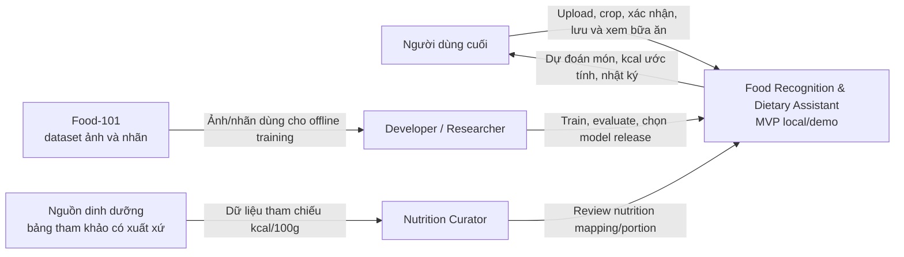

**Không có mũi tên Food-101 → inference request trực tiếp:** training là quy trình offline; runtime sử dụng trained artifact.

### D02 — Container Architecture MVP

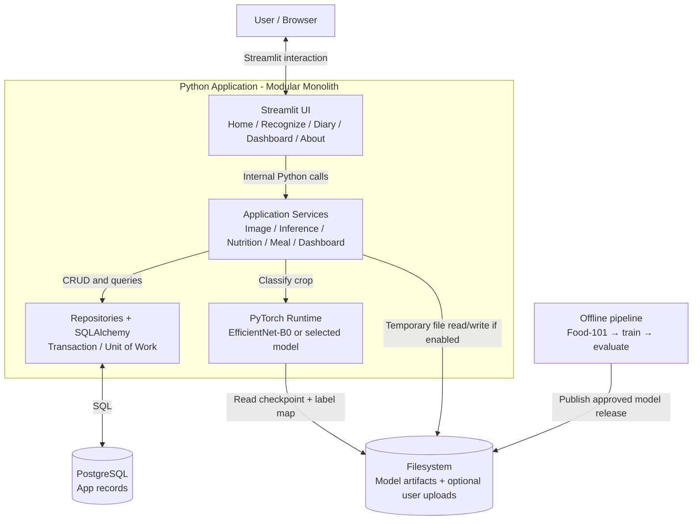

**Ghi chú:** Không có FastAPI, React, remote LLM, Kafka hoặc YOLO trong sơ đồ này.

### D03 — Component Diagram MVP

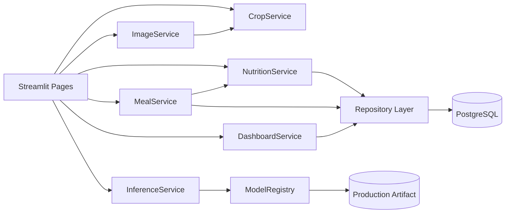

**Rule:** `InferenceService` trả top-k chứ không ghi thẳng meal log. Chỉ `MealService` xử lý save sau user confirmation.

### D04 — Training and Model Selection Pipeline

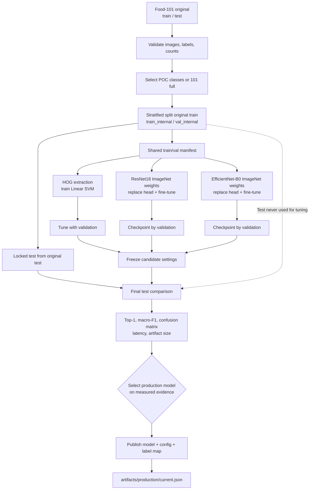

**Bắt buộc:** Giữ `test` độc lập đến bước H; POC subset và full 101 là **hai thí nghiệm khác nhau**.

### D05 — Inference Sequence (không lưu bữa ăn)

```mermaid
sequenceDiagram
    actor U as User
    participant UI as Streamlit Recognize
    participant IS as ImageService
    participant CS as CropService
    participant IN as InferenceService
    participant MR as ModelRegistry
    participant FS as Model Artifact FS

    U->>UI: Upload JPG/PNG
    UI->>IS: validate_and_decode(bytes)
    alt Invalid/too large image
        IS-->>UI: INVALID_IMAGE / IMAGE_TOO_LARGE
        UI-->>U: Hiển thị lỗi, yêu cầu ảnh khác
    else Valid image
        IS-->>UI: PIL RGB image
        UI-->>U: Preview and crop controls
        opt User selects crop
            U->>UI: Choose crop box
            UI->>CS: crop(image, normalized_box)
            CS-->>UI: Cropped RGB
        end
        U->>UI: Click Analyze
        UI->>IN: predict(RGB image/crop, top_k=3)
        IN->>MR: load_production_model()
        MR->>FS: Read model, preprocess, label mapping
        FS-->>MR: Trusted release files
        MR-->>IN: Model + transforms + labels
        alt Missing/inconsistent model
            IN-->>UI: MODEL_NOT_READY / ARTIFACT_MISMATCH
            UI-->>U: Báo lỗi, không tự tạo kết quả
        else Model ready
            Note over IN: eval + inference_mode<br/>resize/normalize match artifact
            IN-->>UI: Top-3 scores, model run_id, uncertain flag
            UI-->>U: Show predictions; require confirmation
        end
    end
```

**Note:** `ModelRegistry` có thể cache, không mở checkpoint từ disk trên mọi request. Sơ đồ mô tả dependency logic, không bắt buộc disk read lại mỗi lần.

### D06 — Nutrition Estimation and Meal Save Sequence

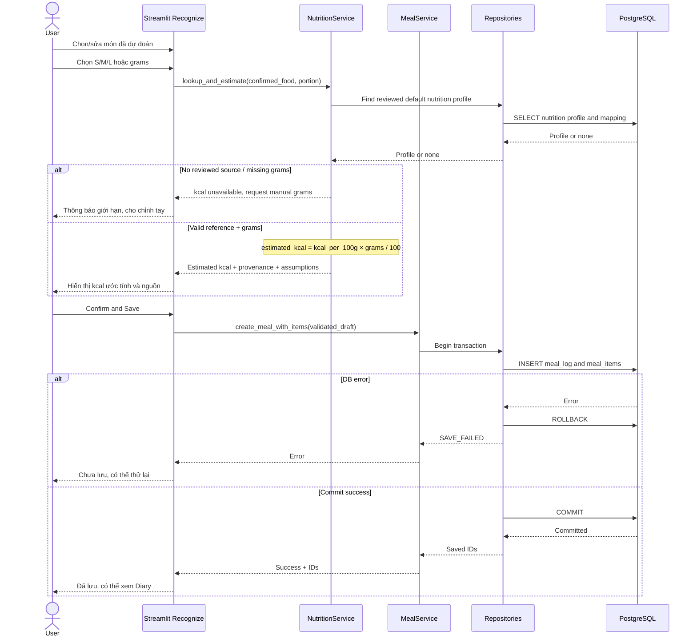

**Invariant:** Khi kcal không có nguồn thì vẫn lưu được `estimated_kcal=NULL`; `manual` kcal phải có dấu vết người dùng nhập.

### D07 — PostgreSQL ER Diagram

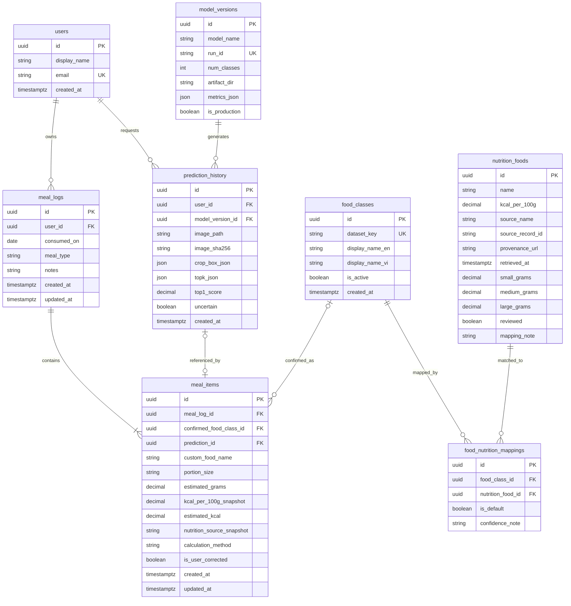

**ERD note:** `model_versions` quản lý release; `class_to_idx` *thuộc model artifact* chứ không phải bảng nghiệp vụ. `prediction_history` và `confirmed_food_class_id` đều có thể NULL theo nghiệp vụ. Mermaid `||--|{ meal_items` biểu thị bản ghi bữa ăn có thể có từ một món sau khi commit; ứng dụng không lưu meal log rỗng cuối transaction. Diagramming agent phải review optionality khi triển khai ORM.

### D08 — User Journey / Activity Flow

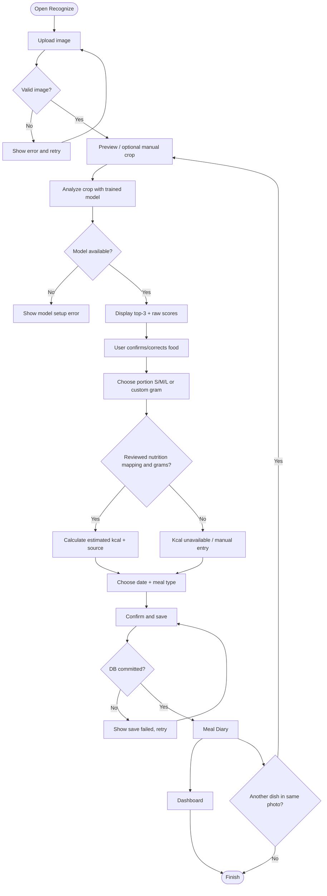

### D09 — Recognize Screen State Machine

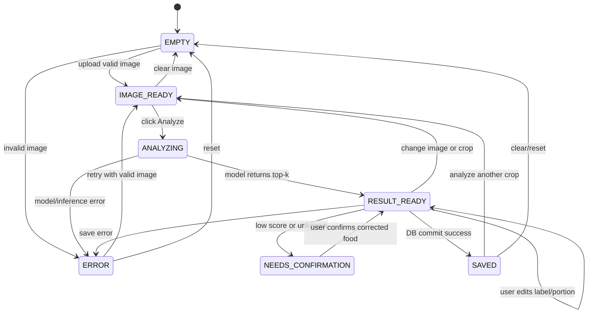

**Quy tắc:** `RESULT_READY → IMAGE_READY` khi thay crop để bỏ kết quả model trước; `SAVED` chỉ sau PostgreSQL commit.

### D10 — Local Deployment Diagram

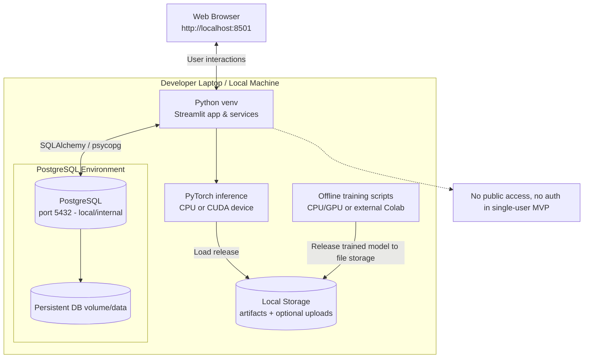

**Nếu training trên Colab**, diễn giải `TRAIN` là máy/cloud khác; chỉ copy release artifacts cần thiết sang host demo và xác minh checksum. PostgreSQL có thể là service local hoặc Compose container, không vẽ một DB cloud mặc định.

### D11 — Roadmap Gantt

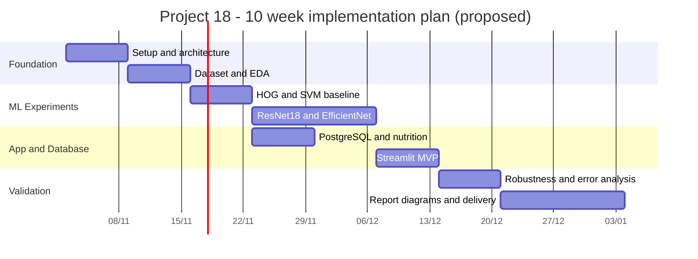

**Note:** Mốc 2026-11-02 chỉ là điểm bắt đầu minh họa sau ngày viết tài liệu, **không phải deadline đã được thầy xác nhận**. Agent có thể vẽ P4 Database song song CNN training; sơ đồ Gantt trên mô tả dependency tối thiểu và mang tính tham khảo.

### D12 — Future Architecture (KHÔNG PHẢI MVP)

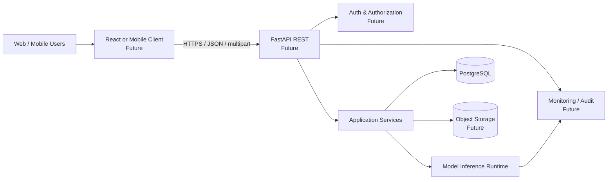

**Cảnh báo in đậm trong output:** `FUTURE ARCHITECTURE — NOT IMPLEMENTED IN MVP`. Không vẽ YOLO/segmentation trong sơ đồ tương lai như tính năng đã sẵn có nếu chưa có dữ liệu detection/segmentation.

---

## 24. MAPPING SƠ ĐỒ ↔ MODULE ↔ TEST

| Diagram | Modules | Tests/checks |
|---|---|---|
| D01 context | All, data sources | Coverage yêu cầu đề |
| D02 container | UI, services, persistence, ML | Smoke end-to-end |
| D03 component | Python services/repo | Unit/Integration contract |
| D04 training | `scripts/train_*`, `ml/*` | Split leakage, metrics validity |
| D05 inference sequence | `recognize`, `image_service`, `inference_service` | UT-01..08, E2E-01 |
| D06 meal save sequence | `nutrition_service`, `meal_service`, ORM | UT-09..14, IT-03..10 |
| D07 ERD | `orm_models.py`, migrations | IT-01, IT-02, referential tests |
| D08 user journey | UI and business services | E2E all scenarios |
| D09 UI state | Streamlit `st.session_state` | image-change, retry, save cases |
| D10 deployment | `.env`, Compose, app startup | Fresh clone smoke test |
| D11 roadmap | Phase/task list | Phases exit criteria |
| D12 future architecture | No MVP modules | Explicitly labeled Future |

## 25. CHECKLIST RÀ SOÁT SƠ ĐỒ CỦA AGENT

- [ ] Đủ 12 diagram names như mục 23.0.
- [ ] Mermaid source syntactically valid hoặc nêu chính xác lỗi chưa render.
- [ ] Trên container diagram, app là modular monolith với Streamlit + Python services.
- [ ] `Food-101` chỉ nằm trong training/data pipeline; runtime đọc artifact.
- [ ] `EfficientNet-B0` là candidate, **không** tự tuyên bố là winner.
- [ ] Có cả ResNet18 và HOG+SVM trong comparison.
- [ ] DB là PostgreSQL, ORM SQLAlchemy, migration Alembic.
- [ ] Nutrition data được map có nguồn; không AI estimate gram chính xác từ 1 ảnh.
- [ ] Có bước user correction trước khi lưu.
- [ ] Một ảnh/crop → một class chính; multi-dish bằng manual crop.
- [ ] Mọi meal save chạy transaction và rollback khi lỗi.
- [ ] ERD chính xác FK, nullable và default mapping.
- [ ] Ký hiệu nguồn external/dataset/model artifact khác database.
- [ ] Future architecture được tách biệt, gắn nhãn Future/Not in MVP.
- [ ] Không có số accuracy/kcal/runs giả trong sơ đồ kết quả.
- [ ] Mỗi sơ đồ có tiêu đề, legend nếu cần, tên file và note quan trọng.

---
